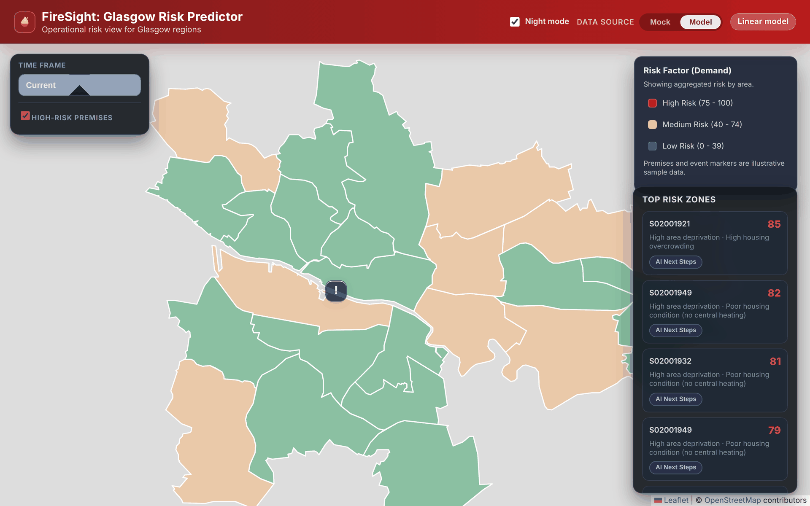

# Fire Sight

A Glasgow fire-risk map for fire and rescue planners: ward risk scores, dwelling-fire forecasts and plain-language explanations.



## Why it is useful

- Shows where to focus home fire safety visits, ranked by deprivation, housing and health indicators.
- Gives each ward a dwelling-fire forecast with a range, built from 14 years of Scottish fire statistics.
- Turns the numbers into three action points per ward, zone or premises.

## Features

- Map of the 23 Glasgow City wards by risk band, with a 6, 12 and 18 month time frame selector.
- Mock or Model data source toggle; Model uses the pipeline scores and forecasts.
- Ranked list of the highest-risk DataZones (746 scored).
- Overlays for 14 illustrative city-centre premises and sample large events.
- "Explain" panel using OpenAI when a key is set, template text otherwise.
- Night mode.

## How it works

The data pipeline (`data-pipeline/`) turns SIMD 2020 and SFRS fire statistics into CSVs. The FastAPI backend (`backend/`) loads them with the ward and premises files and serves JSON. The React and Leaflet frontend (`frontend/fire_website/`) draws the map. Pipeline details: [docs/PIPELINE.md](docs/PIPELINE.md).

## Tech stack

- Backend: Python 3.13, FastAPI, pandas, optional OpenAI API
- Frontend: React 19, Vite, Leaflet
- Data: SIMD 2020, SFRS fire statistics
- Tooling: pytest, GitHub Actions, Render and Vercel configs

## Run locally

```bash
python -m venv .venv && source .venv/bin/activate
pip install -r requirements.txt
python -m uvicorn main:app --app-dir backend --port 8000   # terminal 1

cd frontend/fire_website && cp .env.example .env.local && npm ci && npm run dev   # terminal 2
```

Open http://localhost:5173. Environment variables and deployment: [docs/DEPLOY.md](docs/DEPLOY.md).

## Tests

16 API tests: `python -m pytest -q`.

## Team and my role

Built by Team 7 at the JPMorgan Chase Code for Good hackathon, April 2026: Illia, Monika, Jack MacLeod, Chris Johnson and Yehor Mykhailov (`yehorm14`).

- Built the data pipeline and risk model: SIMD scoring, ward forecasts and the dataset downloader.
- Wired the model output into the API, including the Mock/Model toggle and model-aware explanations.
- Added the tests, CI, deploy configs and this documentation.

## Next steps

- Replace the sample premises and events with real data sources.
- Add seasonality and planned-development inputs to the forecasts. Known limits: [docs/PIPELINE.md](docs/PIPELINE.md).

## Credits / Licence

- Fire statistics by type of incident: Scottish Fire and Rescue Service, via statistics.gov.scot.
- Scottish Index of Multiple Deprivation 2020 (SIMD 2020v2) and indicator data: Scottish Government.
- Both are used under the Open Government Licence v3.0. Map tiles: OpenStreetMap contributors, CARTO.

The code ("Code") in this repository was created solely by the student teams during a coding competition hosted by JPMorgan Chase Bank, N.A. ("JPMC"). JPMC did not create or contribute to the development of the Code. This Code is provided AS IS and JPMC makes no warranty of any kind, express or implied, as to the Code, including but not limited to, merchantability, satisfactory quality, non-infringement, title or fitness for a particular purpose or use.
